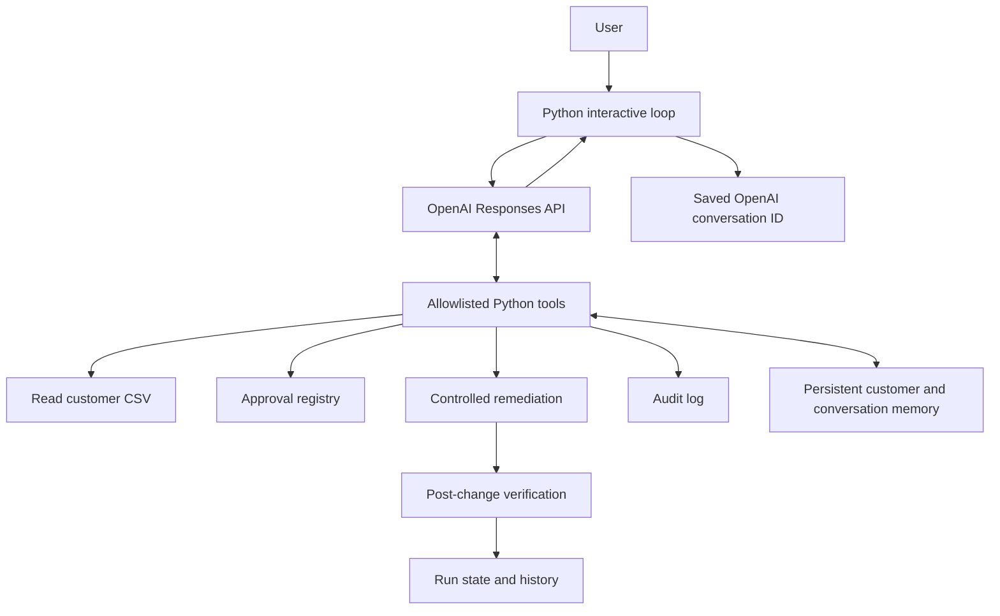

# Stateful Data-Quality AI Agent

A Python-based business automation prototype that combines an LLM tool-calling loop with persistent customer memory, human-approved remediation, audit logging, and automated regression tests.

> **Project status:** Working learning/portfolio prototype. The local regression suite last reported **20 tests passed, 0 failed**. This is not yet a production-ready data platform; see [Limitations and next steps](#limitations-and-next-steps).

## Why this project matters

Business automation needs more than an AI that can answer questions. It needs controlled access to business functions, evidence for actions, persistent context, and tests that catch regressions.

This project explores those patterns through a small customer-revenue data-quality workflow.

## Capabilities

- **Tool-based business analysis:** the model can call defined Python functions to retrieve customer state, inspect history, and check data quality.
- **Persistent customer memory:** customer-specific snapshots are stored locally so information can be retrieved across program runs.
- **Conversation continuity:** an OpenAI Conversation ID is saved in `conversation_memory.json`; the agent can resume a conversation after a restart.
- **Fresh sessions:** `/new` starts a new OpenAI conversation without deleting durable customer memory.
- **Operational commands:** `/help`, `/status`, `/new`, and `exit` are handled locally.
- **Ambiguity handling:** indirect customer references use deterministic memory retrieval; ambiguous phrases such as “the other customer” trigger a clarification instead of selecting a customer arbitrarily.
- **Human-in-the-loop approval:** revenue remediation requires an approval record with a matching customer, approval ID, replacement amount, approver, timestamp, and approved status.
- **Single-use approval lifecycle:** an approved remediation is consumed after a successful fix; replay attempts are rejected.
- **Audit and run history:** actions and workflow results are written to local audit/state files.
- **Regression tests:** automated tests cover memory routing, tool guardrails, approval lifecycle, remediation authorization, and end-to-end workflow behavior.
- **Machine-readable test report:** the test runner writes `day01/agent_test_report.json`.

## Architecture



### Controlled remediation path

1. Inspect the customer data and identify a quality issue.
2. Find an approval for that customer.
3. Reject the remediation if approval is missing, pending, consumed, or mismatched.
4. Apply the approved replacement value through the controlled workflow.
5. Consume the matching approval after the fix succeeds.
6. Re-check data quality and record verification and audit events.

The intended rule is **no valid approval, no data change**. The test suite validates the current implementation using temporary files and mocks for tests that require isolation.

## Project layout

The project is currently developed on Windows in `C:\ai-agent-learning`.

```text
ai-agent-learning/
├── README.md
├── requirements.txt
├── .gitignore
├── day01/
│   ├── first_llm.py                    # Agent, business tools, and interactive loop
│   ├── customers.csv                   # Local customer data (ignored by Git)
│   ├── customers.example.csv           # Sanitized synthetic demo-data template
│   ├── approval_registry.csv           # Local approval records (ignored by Git)
│   ├── approval_registry.example.csv   # Empty approval-registry template
│   ├── agent_audit.csv                 # Action/audit events
│   ├── agent_state.json                # Last run and run history
│   ├── conversation_memory.json        # Messages, customer memory, conversation ID
│   ├── test_memory_routing.py          # Memory retrieval tests
│   ├── test_write_guardrails.py        # Tool allowlist and write guardrail tests
│   ├── test_approval_lifecycle.py      # Approval and consumption tests
│   ├── test_fix_authorization.py       # Remediation authorization tests
│   ├── test_end_to_end_workflow.py     # Isolated workflow integration tests
│   ├── run_agent_tests.py              # Combined test runner and JSON report
│   └── agent_test_report.json          # Generated test summary
└── README.md
```

Some files are created locally when the agent runs. Do not commit private logs, session state, API keys, or real customer data to a public repository.

## Requirements

- Python 3.13 (the current development environment) or a compatible Python version supported by your installed OpenAI SDK.
- An OpenAI API project with API access and a model enabled for that project.
- The `openai` Python package.
- PowerShell on Windows for the commands below; commands can be adapted for other operating systems.

## Setup on Windows

Open PowerShell in the project directory:

```powershell
cd C:\ai-agent-learning
```

Create and activate a virtual environment if you do not already have one:

```powershell
python -m venv .venv
.\.venv\Scripts\Activate.ps1
```

Install the OpenAI SDK:

```powershell
python -m pip install -r requirements.txt
```

For a **fresh clone only**, initialize local demo files from the sanitized templates:

```powershell
Copy-Item .\day01\customers.example.csv .\day01\customers.csv
Copy-Item .\day01\approval_registry.example.csv .\day01\approval_registry.csv
```

Do not run those copy commands over existing files you want to preserve. The example customer data includes a negative Globex value so you can demonstrate the approval-controlled remediation workflow. The template files are synthetic and contain no API credentials.

Set the API key in the current PowerShell session. Replace the placeholder with your own key; do not paste the key into source code or publish it:

```powershell
$env:OPENAI_API_KEY = "YOUR_API_KEY"
```

The current script uses a model identifier configured in `first_llm.py`. Make sure it is available to your API project before running the agent.

## Run the agent

After setting `OPENAI_API_KEY` and initializing the demo files in a fresh clone, run:

```powershell
python .\day01\first_llm.py
```

Example local commands:

```text
/help
/status
/new
exit
```

Example business questions:

```text
What is the current state of Acme?
What do you remember about Globex?
Was that remediation successful?
What happened to Globex recently?
```

Names and values in the demo data are illustrative. Replace them with synthetic data before sharing screenshots or logs publicly.

## Run the automated tests

Run the combined suite from the project root:

```powershell
python .\day01\run_agent_tests.py
```

The runner executes the test groups and writes a JSON report to `day01/agent_test_report.json`. A nonzero exit code indicates that at least one group failed.

The last test run reported:

| Test group | Tests | Result |
|---|---:|---|
| Memory routing | 4 | PASS |
| Write guardrails | 3 | PASS |
| Approval lifecycle | 3 | PASS |
| End-to-end workflow | 2 | PASS |
| Remediation authorization | 8 | PASS |
| **Total** | **20** | **PASS** |

Test results describe the run captured during development; run the suite again to verify the current checkout.

## Safety and design choices

- Tools are allowlisted; unknown tools are blocked.
- Direct calls to low-level write tools are blocked by the dispatcher; controlled workflow execution is the intended route.
- The remediation function independently validates approval details before writing customer data.
- Approval records transition through states such as `PENDING`, `APPROVED`, and `CONSUMED`.
- Remediation is followed by a quality re-check.
- Tests that exercise file writes use temporary directories and/or mocked functions to avoid changing real project files.
- Conversation state and customer business memory are stored separately from the API's conversation identifier, allowing a fresh conversation without discarding business memory.

## Current limitations

This is a portfolio prototype, not a production deployment. Before real business use, address at least these areas:

- **Storage:** CSV and JSON files are suitable for a learning prototype, but they do not provide transactional guarantees or robust concurrent-write handling.
- **Approval integrity:** a local CSV registry can be modified by anyone with file access. Production approvals should use authenticated identities, access-controlled storage, and tamper-evident audit records.
- **Concurrency:** simultaneous agent runs could race while updating customer data, approvals, or memory.
- **Secrets and privacy:** keep API keys and any real customer data out of source control, screenshots, and public reports.
- **Observability:** production use would require structured logging, monitoring, error handling, retries, and alerting.
- **Testing:** current automated tests verify selected behavior with isolated data and mocks; they do not prove production security or test every possible failure mode.
- **Human approval:** a supplied approver name is not, by itself, proof of identity. Production systems should authenticate and authorize the reviewer outside the LLM.

## Roadmap

1. Add repository hygiene (`.gitignore`, dependency pinning, and safe demo-data handling).
2. Make model selection configurable through an environment variable.
3. Add structured logs and clear API/network error handling.
4. Extend tests for invalid data, file corruption, duplicate approvals, and failure between remediation and approval consumption.
5. Replace CSV/JSON persistence with a transactional database if multi-user or production use is needed.
6. Add a short demo script and sanitized screenshots for a portfolio presentation.

## Portfolio summary

**Built a stateful AI business agent in Python** with OpenAI tool calling, persistent customer memory, human-approved data remediation, approval validation, audit logging, recovery of unavailable conversations, and a 20-test automated regression suite. The prototype demonstrates how LLM reasoning can be combined with deterministic controls and testable business operations.
